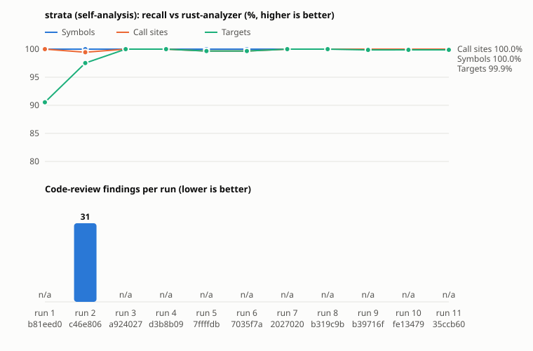
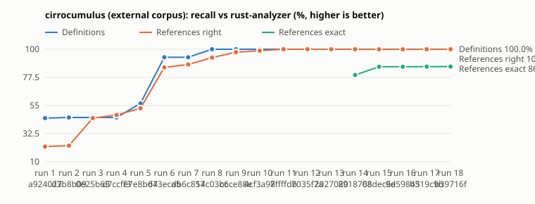

# strata

Clean-room, compiler-backed code intelligence in Rust: a tree-sitter index (Rust, Python,
JavaScript and HTML/CSS today; C/C++ planned) that answers who-defines, who-calls and
what-breaks questions for humans and agents. Independently designed from public descriptions
of code-intelligence tools; it contains no code or assets from any other product.

```
cargo build
./target/debug/strata symbols walk          # find definitions
./target/debug/strata callers walk.walk     # who calls it, with edge states
./target/debug/strata call overview '{}'    # agent tool surface (JSON); see `strata guide`
```

Agent usage lives in [`docs/agents/using-strata.md`](docs/agents/using-strata.md).

## Self-analysis metrics

strata indexes its own source on every milestone and is scored against rust-analyzer's SCIP
index of the same commit (an independent ground truth). `scripts/metrics.py` produces every
number and the chart below; see [Metrics](CLAUDE.md#metrics) for when to run it.

- **Symbol recall**: share of rust-analyzer's fn/method/type definitions that strata lists.
- **Call-site recall**: share of calls to workspace functions where strata recorded an edge.
- **Target recall**: as above, but the edge's resolved/candidate targets include the right function.
- **False external**: calls to workspace functions that strata reported as `external`.
- **Review findings**: items raised by the two-axis code review (standards / spec) plus
  correctness or security notes found along the way. `–` means no review was run for that commit.

<!-- metrics:start -->



| Run | Rev | What changed | Symbol recall | Call-site recall | Target recall | False external | Unresolved | Review findings (std / spec / correctness) |
| ---: | --- | --- | ---: | ---: | ---: | ---: | ---: | --- |
| 1 | `b81eed0` | first Rust plugin | 100.0% | 100.0% | 90.5% | 7 | 991 | – |
| 2 | `c46e806` | agent tools + resolver fixes (reviewed) | 100.0% | 99.5% | 97.5% | 7 | 0 | 31 (11 / 11 / 9) |
| 3 | `a924027` | crate-root mods + match-guard fixes | 100.0% | 100.0% | 100.0% | 0 | 0 | – |
| 4 | `d3b8b09` | fixes for cirrocumulus gaps | 100.0% | 100.0% | 100.0% | 0 | 0 | – |
| 5 | `7ffffdb` | depth 1-6 (all connection types) | 100.0% | 99.7% | 99.7% | 0 | 12 | – |
| 6 | `7035f7a` | depth 6b: noise removed | 100.0% | 99.7% | 99.7% | 0 | 2 | – |
| 7 | `2027020` | depth 6c: turbofish chains, #[path] mods | 100.0% | 100.0% | 100.0% | 0 | 2 | – |
| 8 | `b319c9b` | depth 8: receiver typing | 100.0% | 100.0% | 100.0% | 0 | 2 | – |
| 9 | `b39716f` | depth 9: strata map | 100.0% | 100.0% | 99.9% | 1 | 2 | – |
| 10 | `fe13479` | JS plugin + shared globals + external-rooted chains | 100.0% | 100.0% | 99.9% | 1 | 2 | – |
| 11 | `35ccb60` | HTML/CSS markup index; walker indexes html/css | 100.0% | 100.0% | 99.9% | 1 | 2 | – |
| 12 | `2dd0724` | DOM-JS linking (selector_refs) | 100.0% | 100.0% | 99.9% | 1 | 2 | – |
| 13 | `e6fbfdf` | pages + stylesheets tools | 100.0% | 100.0% | 99.9% | 1 | 2 | – |
| 14 | `f81ce40` | code-review fixes (web languages) | 100.0% | 100.0% | 99.9% | 1 | 2 | 21 (11 / 8 / 2) |
| 15 | `561be67` | daemon + thin client (reviewed) | 100.0% | 100.0% | 100.0% | 0 | 4 | 20 (8 / 10 / 2) |


<!-- metrics:end -->

<!-- metrics-cirrocumulus:start -->

### cirrocumulus (external corpus)

The same scoring on a repository outside strata. Run 1 is strata's first look at it, before any cirrocumulus-specific fix; later runs include fixes for the gaps run 1 exposed, so read them as tuned, not blind. `strata` is the commit under test, `corpus` the commit of the repo it indexed.



| Run | strata | corpus | What changed | Definitions | References seen | References right | References exact | False external | Unresolved | Map tokens (source) | Map QA where / fields / callers |
| ---: | --- | --- | --- | ---: | ---: | ---: | ---: | ---: | ---: | ---: | --- |
| 1 | `a924027` | `a8cf4eb` | baseline, before cirrocumulus fixes | 44.9% | 22.6% | 22.2% | – | 0 | 11 | – | – |
| 2 | `d3b8b09` | `a8cf4eb` | gaps fixed: shadowing, globs, json macros, derives, turbofish, aliases, ioctl | 45.4% | 22.9% | 22.9% | – | 0 | 0 | – | – |
| 3 | `0e25b63` | `a8cf4eb` | depth 1: type references | 45.4% | 45.0% | 45.0% | – | 0 | 23 | – | – |
| 4 | `d7ccff3` | `a8cf4eb` | depth 1: type references (+ctors, turbofish, macros) | 45.4% | 47.4% | 47.4% | – | 0 | 29 | – | – |
| 5 | `e7e8bd4` | `a8cf4eb` | depth 2: fn/const/static values | 56.7% | 52.8% | 52.8% | – | 0 | 29 | – | – |
| 6 | `673eca5` | `a8cf4eb` | depth 3: fields + variant defs | 93.6% | 85.4% | 85.4% | – | 0 | 31 | – | – |
| 7 | `db6c857` | `a8cf4eb` | depth 4: variant references | 93.6% | 87.8% | 87.8% | – | 0 | 31 | – | – |
| 8 | `14c03bc` | `a8cf4eb` | depth 5: modules + imports | 100.0% | 93.3% | 93.3% | – | 0 | 31 | – | – |
| 9 | `c6ce88e` | `a8cf4eb` | depth 5: modules + imports (+super, pub(crate)) | 100.0% | 97.6% | 97.6% | – | 0 | 31 | – | – |
| 10 | `4cf3a98` | `a8cf4eb` | depth 5c: namespaces, local items, attribute paths | 100.0% | 98.9% | 98.9% | – | 0 | 33 | – | – |
| 11 | `7ffffdb` | `a8cf4eb` | depth 6: long tail (shorthand locals, macros, inline modules) | 100.0% | 100.0% | 100.0% | – | 0 | 33 | – | – |
| 12 | `7035f7a` | `a8cf4eb` | depth 6b: noise removed (0 unresolved) | 100.0% | 100.0% | 100.0% | – | 0 | 1 | – | – |
| 13 | `2027020` | `a8cf4eb` | depth 6c: turbofish chains, #[path] mods | 100.0% | 100.0% | 100.0% | – | 0 | 1 | – | – |
| 14 | `8918708` | `a8cf4eb` | depth 7: trait impls | 100.0% | 100.0% | 100.0% | 79.4% | 0 | 1 | – | – |
| 15 | `68dec6e` | `a8cf4eb` | depth 8: receiver typing | 100.0% | 100.0% | 99.9% | 86.0% | 2 | 1 | – | – |
| 16 | `9d59845` | `a8cf4eb` | depth 8b: impls outside the type's module | 100.0% | 100.0% | 99.9% | 86.0% | 2 | 1 | – | – |
| 17 | `b319c9b` | `a8cf4eb` | depth 8c: path-vs-local fixes | 100.0% | 100.0% | 100.0% | 86.1% | 0 | 1 | – | – |
| 18 | `b39716f` | `a8cf4eb` | depth 9: strata map (all levels fit) | 100.0% | 100.0% | 100.0% | 86.1% | 0 | 1 | 31,894 (82,151) | 100% / 92% / 96% |
| 19 | `fe13479` | `a8cf4eb` | JS plugin + shared globals + external-rooted chains | 100.0% | 100.0% | 100.0% | 86.1% | 0 | 1 | 31,894 (82,151) | 100% / 92% / 96% |
| 20 | `35ccb60` | `a8cf4eb` | HTML/CSS markup index; walker indexes html/css | 100.0% | 100.0% | 100.0% | 86.1% | 0 | 1 | 31,894 (82,151) | 100% / 92% / 96% |
| 21 | `2dd0724` | `a8cf4eb` | DOM-JS linking (selector_refs) | 100.0% | 100.0% | 100.0% | 86.1% | 0 | 1 | 31,894 (82,151) | 100% / 92% / 96% |
| 22 | `e6fbfdf` | `a8cf4eb` | pages + stylesheets tools | 100.0% | 100.0% | 100.0% | 86.1% | 0 | 1 | 31,894 (82,151) | 100% / 92% / 96% |
| 23 | `f81ce40` | `a8cf4eb` | code-review fixes (web languages) | 100.0% | 100.0% | 100.0% | 86.1% | 0 | 1 | 31,894 (82,151) | 100% / 92% / 96% |
| 24 | `561be67` | `a8cf4eb` | daemon + thin client | 100.0% | 100.0% | 100.0% | 86.1% | 0 | 1 | 31,894 (82,151) | 100% / 92% / 96% |

Latest run (`561be67`) by connection type. *seen*: strata recorded a connection at that spot; *right*: and its targets include the correct definition.

| Connection | Total | Seen | Right | Exact |
| --- | ---: | ---: | ---: | ---: |
| reference: call | 806 | 100.0% | 100.0% | 72.8% |
| reference: const | 112 | 100.0% | 100.0% | 100.0% |
| reference: field | 609 | 100.0% | 100.0% | 81.9% |
| reference: impl_block | 13 | 100.0% | 100.0% | 100.0% |
| reference: impl_method | 10 | 100.0% | 100.0% | 100.0% |
| reference: import | 122 | 100.0% | 100.0% | 100.0% |
| reference: module | 105 | 100.0% | 100.0% | 100.0% |
| reference: type | 462 | 100.0% | 100.0% | 100.0% |
| reference: value | 18 | 100.0% | 100.0% | 100.0% |
| reference: variant | 107 | 100.0% | 100.0% | 100.0% |
| definition: const | 70 | 100.0% | – |
| definition: field | 186 | 100.0% | – |
| definition: fn | 329 | 100.0% | – |
| definition: module | 40 | 100.0% | – |
| definition: type | 54 | 100.0% | – |
| definition: variant | 43 | 100.0% | – |


Other commits of the corpus (code strata was never fixed against; not part of the series above):

| strata | corpus | Definitions | References seen | References right | Calls right | Unresolved |
| --- | --- | ---: | ---: | ---: | ---: | ---: |
| `8918708` | `13cb233` | 100.0% | 100.0% | 99.9% | 99.9% | 2 |

<!-- metrics-cirrocumulus:end -->
